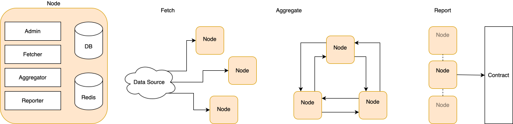
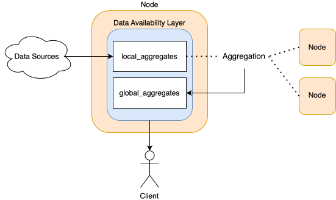

# Orakl Node

**Orakl Node for Off-Chain Aggregation**

## Table of Contents

- [Introduction](#introduction)
- [Project Structure](#project-structure)
- [Packages](#packages)
  - [Main Elements](#main-elements)
- [Quickstart](#quickstart)
  - [Prerequisites](#prerequisites)
  - [Setup `.env`](#setup-env)
  - [Database Initialization](#database-initialization)
  - [Optional Setups](#optional-setups)
  - [Run Node](#run-node)
- [DAL](#dal)
  - [API keys](#api-keys)
  - [Metrics](#metrics)
  - [Migrating keys from PostgreSQL](#migrating-keys-from-postgresql)
- [Other Task Commands](#other-task-commands)
  - [Unit Test](#unit-test)
  - [Commands](#commands)
  - [Scripts](#scripts)
  - [CLI](#cli)
- [Troubleshooting](#troubleshooting)
  - [`Kaia` package compile error](#kaia-package-compile-error)

## Introduction

Off-chain aggregator performs the following steps to regularly submit data into the chain:

1. Fetch price data and save it into the database.
2. Send and receive data with other nodes, aggregate all received data, and save aggregated data into the database.
3. Submit aggregated data into the chain.

<figure><figcaption><p>Set of `Admin`, `fetcher`, `aggregator`, and `reporter` runs in a single Orakl Node</p></figcaption></figure>

<figure><figcaption><p>Data Availability Layer</p></figcaption></figure>

## Project Structure

Modular Monolithic with loose coupling between packages:

- `cmd`: Holds entry points to run basic functionalities.
- `migrations`: Migration files to initialize PostgreSQL tables.
- `pkg`: Implementation packages for off-chain aggregator.
- `script`: Scripts for testing purposes, such as smoke tests or temporary usage.
- `taskfiles`: Taskfile holding commands to run the application.

## Packages

Check the source code inside `./pkg` for details:

- **Boot**: Handles peer initial connection. One Boot API should be running for node meshes.
- **Admin**: Provides an API for the user interface, performing CRUD operations for system tables and controlling other packages through bus messages (e.g., stopping fetcher).
- **Aggregator**: Shares recently fetched data with other aggregators and saves it as `global_aggregate`.
- **Bus**: Facilitates message bus communication among multiple packages.
- **DB**: Offers helper functions for querying PostgreSQL or Redis databases.
- **Fetcher**: Regularly retrieves data from the data source and stores it in the database.
- **Libp2p**: Assists in utilizing the libp2p package at a higher level.
- **Raft**: Implements simple raft consensus for leader election and syncing among multiple peers.
- **Reporter**: Submits data from `global_aggregates` with the latest Round to the chain.
- **Utils**: Contains helper functions usable among other packages.
- **Por**: Package to run a separate service for POR.
- **wss**: Helper package for websocket implementation
- **websocketfetcher**: Fetcher app based on websocket
- **dal**: Data Availability Layer API

### Main Elements

- **Admin API**: Supports an interface to add entries to the table or control internal applications.
- **Fetcher**: Continuously retrieves data from the data source for entries declared in the adapters table.
- **Aggregator**: Sends and receives locally fetched data to/from other off-chain aggregators, storing it in the `global_aggregates` table.
- **Reporter**: Submits all data from `global_aggregates` with the most recent round.

## Quickstart

### Prerequisites

Ensure you have the following installed and set up:

- Go: [Installation Guide](https://go.dev/doc/install)
- golang-migrate: [Installation Guide](https://github.com/golang-migrate/migrate/releases)
- go-taskfile: [Installation Guide](https://taskfile.dev/installation/)
- PostgreSQL: [Installation Guide](https://www.postgresql.org/download/)
- Redis: [Installation Guide](https://redis.io/docs/install/install-redis/install-redis-on-linux/)

### Setup `.env`

```sh
# Application port for the admin API, defaults to 8088
APP_PORT=<Your App Port>

# PostgreSQL connection URL
DATABASE_URL=<Your Database URL>

# Redis host, defaults to localhost
REDIS_HOST=<Your Redis Host>

# Redis port, defaults to 6379
REDIS_PORT=<Your Redis Port>

# provider URL for `kaia_helper`
KAIA_PROVIDER_URL=<Your Provider URL>

# provider URL for `eth_helper`
ETH_PROVIDER_URL=<Provider URL>

# Contract for submission
SUBMISSION_PROXY_CONTRACT=<Your Submission Proxy Contract>

# Delegator URL, tx fee is directly paid from reporter if not provided
DELEGATOR_URL=<Your Delegator URL>

# Signer PK generates a signature value for submission based on this value. EOA address should be whitelisted in the SubmissionProxy contract to be used.
SIGNER_PK=<Your Signer PK>

# Encrypt Password, this is referenced to store encrypted wallet pk into table. defaults to 'anything'
ENCRYPT_PASSWORD=<Your Encrypt Password>

# Chain name, 'kairos', 'mainnet', or 'test'
CHAIN=<Your Chain Name>

# tx submission wallet for `kaia_helper`
KAIA_REPORTER_PK=<Your Reporter PK>

# tx submission wallet for `eth_helper`
ETH_REPORTER_PK=<Reporter PK>

# Referenced from test code, EOA of fee payer
TEST_FEE_PAYER_PK=<Your Test Fee Payer PK>

# Required for secure connection
PRIVATE_NETWORK_SECRET=<Your Private Network Secret>

# Port for Boot API, defaults to 8089
BOOT_API_PORT=<Your Boot API Port>

# Boot API connection URL
BOOT_API_URL=<Your Boot API URL>

# Boot API SQLite peer file, required by the Boot API (not by nodes)
BOOT_SQLITE_PATH=<Path, e.g. ./boot.db>

# Pinger priviliged set, not required from built image
WITHOUT_PING_PRIVILEGED=<Set true if running local>

# provider URLs referenced from fetcher, uses public JSON-RPC if not provided
FETCHER_CYPRESS_PROVIDER_URL=<Your Cypress provider URL>
FETCHER_ETHEREUM_PROVIDER_URL=<Your Ethereum provider URL>
```

### Database Initialization

After go-migrate is installed, run migration with the following command:
More details about go migrate cli command can be found [here](https://github.com/golang-migrate/migrate/tree/master/cmd/migrate)

```sh
# node
migrate -database "{$DATABASE_URL}" -path ./migrations/node up
```

This process will generate required tables and constraints to run the service.

### Optional Setups

Following are optional setups which helps the application run more smoothly.

1. Proxies

Proxies are referenced from fetcher to prevent being blocked from 3rd party data providers. If provided, fetcher will utilize proxy requests

2. Wallets

Wallets are referenced from reporter. If provided, each wallet will take a turn for submissions.

3. JSON-RPCs

JSON-RPCs are referenced from both fetcher and reporter. If provided, it'll try to use provided JSON-RPCs as a fallback in case of JSON-RPC failure.

---

If you want to set these settings, use [cli commands](#cli) while admin API is running. Admin API is run together while the node is running, or you can run Admin API separately without running the whole service through the following task command

```sh
task local:admin
```

- Run CLI commands while the admin API is running (e.g., `task local:add-wallet PK=0x123`).
- If the whole service was running when adding the settings, refresh the related service to apply changes (e.g., `task local:refresh-reporter`).

### Run Node

Follow these steps to set up and run the application:

1. **Set up the database**: Ensure PostgreSQL and Redis are running. PostgreSQL should have tables based on migration files.
2. **Copy .env.local to .env**: Copy the local environment settings to the main environment file

```sh
cp .env.local .env
```

3. **Update environment variables**: Replace `DATABASE_URL`, `KAIA_REPORTER_PK`, `SIGNER_PK`, and other values with valid ones in the .env file.
4. **Run Boot API**:
   skip this step if connecting to pre-existing boot api

   ```sh
   task local:boot-api
   ```

5. **Run Node**: Execute this from a different shell.

   ```sh
   task local:node
   ```

## Boot API

Boot API does not use PostgreSQL. Peers (`peers(id, url UNIQUE)`) are stored in a SQLite file.

| Env                | Description |
| ------------------ | ----------- |
| `BOOT_SQLITE_PATH` | Required. Path of the SQLite peer file, e.g. `/app/data/boot.db`. Put it on a persistent volume. Boot API refuses to start if unset. A missing file is created empty: nodes register themselves via `POST /api/v1/peer/sync` (at startup and on reconnect), and unreachable peers are removed every 10s. The directory must be writable (SQLite WAL files). |
| `BOOT_API_PORT`    | Optional, defaults to `8089`. |

`DATABASE_URL` is not used. The image runs `bootbin` directly (no migrations).

Peers can be inspected or seeded with the `peers` subcommand (`bootbin` in the image, `go run ./cmd/boot_api` locally):

```sh
bootbin peers list               # id<TAB>url
bootbin peers import peers.txt   # one url per line, known urls skipped; "-" reads stdin
```

### Migrating peers from PostgreSQL

Optional: a new empty file refills as nodes re-register. Nodes only call `/peer/sync` at startup and after a disconnect, so a new file stays empty until then; to keep the current mesh discoverable, import the old table once:

```sh
psql -v ON_ERROR_STOP=1 -At "$OLD_DATABASE_URL" -c "SELECT url FROM peers ORDER BY id" \
  | BOOT_SQLITE_PATH=/app/data/boot.db bootbin peers import -
BOOT_SQLITE_PATH=/app/data/boot.db bootbin peers list
```

Stale urls are removed by the refresh loop once Boot API runs.

## DAL

DAL does not use PostgreSQL. API keys are stored in a SQLite file and usage is exposed as Prometheus metrics.

| Env               | Description                                                                                      |
| ----------------- | ------------------------------------------------------------------------------------------------ |
| `DAL_SQLITE_PATH` | Required. Path of the SQLite key file, e.g. `/app/data/dal.db`. Put it on a persistent volume. DAL refuses to start if the file does not exist; `keys add`/`keys import` create it. The directory must be writable (SQLite WAL files). |
| `CHAIN`           | Required. `kairos`, `mainnet` or `test`.                                                          |
| `REDIS_HOST`, `REDIS_PORT` | Redis used by the collector.                                                            |

### API keys

Keys are managed with the `keys` subcommand of the DAL binary (`dalbin` in the image, `go run ./cmd/dal` locally), against the file at `DAL_SQLITE_PATH`:

```sh
dalbin keys list                       # key<TAB>description
dalbin keys add <key> <description>    # add, or update description
dalbin keys remove <key>
dalbin keys import keys.csv            # "key,description" rows, no header; "-" reads stdin
```

`keys add` takes the key as an argument, so it lands in shell history. To avoid that, read the key silently and pipe it:

```sh
read -rs -p 'API key: ' k; echo
printf '%s,%s\n' "$k" "<description>" | dalbin keys import -
unset k
```

The description is used as the `key` label of the metrics, so give every key a short, unique one. A new key works immediately. A removed key, or a changed description, can take up to 1 hour (key cache TTL) to apply to new requests and new WebSocket connections. Established WebSocket connections are only checked at connect time and are not dropped when their key is removed; restart DAL to apply at once and drop them.

`keys import` only adds or updates keys; it never deletes keys missing from the CSV.

The file can also be edited with `sqlite3` (`keys(key TEXT UNIQUE, description TEXT)`).

### Metrics

Served at `GET /metrics` on the API port (8090). `key` is the key description, `unknown` for a missing or invalid key, `unnamed` for a key with an empty description. `endpoint` is the route template (e.g. `/latest-data-feeds/{symbols}`), `other` for unmatched paths. Descriptions equal to a reserved label (`unknown`, `error`, `unnamed`) or starting with `key_` are exported as `key_<description>`, so distinct descriptions never share a label. A key-store failure returns 503 (`key="error"`). `dal_websocket_subscriptions_total` counts new subscriptions to known symbols (repeats not counted).

`/metrics` needs no API key and exposes key descriptions with their traffic; do not expose it publicly.

- `dal_rest_requests_total{key, endpoint, status}`
- `dal_websocket_connections_total{key}`
- `dal_websocket_active_connections{key}`
- `dal_websocket_subscriptions_total{key}` (valid symbols only)

### Migrating keys from PostgreSQL

One-time export of the old `keys` table and import into a **new, empty** SQLite file. Usage history is not migrated.

```sh
(
  set -euo pipefail
  umask 077
  export_dir="$(mktemp -d)"
  trap 'rm -rf -- "$export_dir"' EXIT
  psql -v ON_ERROR_STOP=1 "$OLD_DATABASE_URL" -c "\copy (SELECT key, COALESCE(description, '') FROM keys ORDER BY id) TO '$export_dir/keys.csv' WITH CSV"
  test -s "$export_dir/keys.csv"
  DAL_SQLITE_PATH=/app/data/dal.db dalbin keys import "$export_dir/keys.csv"
  DAL_SQLITE_PATH=/app/data/dal.db dalbin keys list
)
```

The CSV holds live API keys, hence the private directory under `umask 077`, removed on exit. The subshell stops at the first failure (failed export, empty CSV, failed import), so it never finishes "successfully" with an empty key store.

Because `import` never deletes, re-running it against an existing file keeps keys that were revoked in PostgreSQL since the last run. To repeat the migration, delete the SQLite file first, or remove the revoked keys with `dalbin keys remove` and check `dalbin keys list` against PostgreSQL before cutover.

## Other Task Commands

### Unit Test

```sh
# Run all tests
task local:test
```

### Commands

```sh
# Run Boot API
task local:boot-api

# Run Admin API
task local:admin

# Run Node
task local:node
```

### Scripts

```sh
# Submission test: submit a single tx on chain
task local:script-submission

# Fetcher test: run api + fetcher
task local:script-fetcher-test

# Fetcher-aggregator test: run api + fetcher + aggregator
task local:script-fetcher-aggregator-test

# Test connection: check if nodes properly connect through boot api
task local:script-test-connection

# Test raft: run simple raft node to test its functionality
task local:script-test-raft
```

### CLI

```sh
# check if admin api is live
task local:check-api

# sync config
task local:sync

# refresh fetcher, trigger it after adding proxy or json rpc. Execute only if service is running.
task local:refresh-fetcher

# refresh reporter, trigger it after adding wallet or json rpc. Execute only if service is running.
task local:refresh-reporter

# refresh aggregator, reloads aggregators and signers.
task local:refresh-aggregator

# `LOCATION` is an optional parameter
task local:add-proxy HOST="127.0.0.2" PORT=8080 PROTOCOL="http" LOCATION="kr"

# get all registered proxies
task local:get-proxy

# remove proxy by id
task local:remove-proxy ID=10

# add a wallet which triggers submission
task local:add-wallet PK=0x123

# get all registered wallets
task local:get-wallet

# remove wallet by id
task local:remove-wallet ID=10

# renew current signer
task local:renew-signer

# add fallback JSON-RPC, lower priority value will be referenced first
task local:add-json-rpc CHAIN_ID=1001 URL="http://test.com" PRIORITY=10

# get all registered fallback JSON-RPC
task local:get-json-rpc

# remove fallback json-rpc
task local:remove-json-rpc ID=10
```

## Troubleshooting

### `Kaia` package compile error

[Reference](https://github.com/klaytn/klaytn/issues/197#issuecomment-612597933)

1. Install C compilers

```sh
# use the appropriate command depending on the instance environment
sudo apt-get install -y g++-x86-64-linux-gnu libc6-dev-amd64-cross
```

2. Set variables

```sh
set CGO_ENABLED=1
set CC=[c cross compiler]
set GOOS=linux
set GOARCH=amd64
```

# POR

Por service stands for proof of reserve. To be updated later, with scalability to support multiple providers.

## Quickstart

### Set .env variables

```sh
# POR
POR_REPORTER_PK=
POR_CHAIN=
POR_PROVIDER_URL=
# (optional) defaults to 3000
POR_PORT=
```

### Run

```sh
task local:por
```

# Sentinel

# Orakl sentinel

Orakl sentinel is a service for monitoring Orakl Service.
It checks the service state regularly and sends a Slack message if required.

## Project Structure

- `cmd`: Holds the entry point (`./cmd/sentinel/main.go`) to run the service.
- `pkg/checker`: Packages with implementations

### Packages

- `pkg/alert`: Alert package to send Slack messages on request.
- `pkg/checker`: Checker implementations

### Setup `.env`

```sh
# Log level for running the application, options such as `debug`, `info`, `error` are possible
LOG_LEVEL=error
# Infra chain info, defaults to kairos (Kaia testnet)
CHAIN=kairos
# Health checker interval, defaults to 10s
HEALTH_CHECK_INTERVAL=10s
# Balance checker interval, this is balance update interval and defaults to 10s
BALANCE_CHECK_INTERVAL=10s
# Balance alarm interval, this is alarm interval and defaults to 30m
BALANCE_ALARM_INTERVAL=30m
# Minimal required balance for submitters, defaults to 25
SUBMITTER_ALARM_AMOUNT=25
# Minimal required balance for fee payer, defaults to 10000
DELEGATOR_ALARM_AMOUNT=10000

# (required) JSON RPC URL for on-chain calls
JSON_RPC_URL=
# (required) Orakl API URL to retrieve reporter addresses
ORAKL_API_URL=
# (required) Orakl Node Admin URL to retrieve wallet addresses
ORAKL_NODE_ADMIN_URL=
# (required) Orakl Delegator URL to retrieve fee payer address
ORAKL_DELEGATOR_URL=
# (required) POR URL to retrieve POR reporter address
POR_URL=
# (required) Slack webhook URL
SLACK_WEBHOOK_URL=
# (required) Submission proxy contract to read signer expiration
SUBMISSION_PROXY_CONTRACT=
```

## Checkers

### Health Checker

Calls health check URLs regularly and sends an alarm if the service is not alive.

- Prerequisites

Ensure that JSON files are correctly defined in `./pkg/checker/health`.
The JSON file containing the health check URL can be generated by running the `./script/collect-healthcheck-urls` script.

```sh
go run ./script/collect-healthcheck-urls --chain={CHAIN} --kubeconfig={PATH_TO_KUBECONFIG} --context={K9S_CONTEXT}
```

Default values are as follows:

```sh
chain = "baobab"
kubeconfig = "/Users/${USER}/.kube/config"
contextName = "orakl-baobab-admin@bisonai"
```

### Balance Checker

Reads Orakl service wallets regularly and sends an alarm if the amount is less than the minimum.


### DAL Checker

Checks DAL service status

### Peers Checker

Check orakl node cluster peer counts

### Signer Checker

Check signer expirations from contracts

# Orakl Network API

## Structure

- `./cmd/api/main.go` : entrypoint to run api server
- `./pkg/api/utils/utils.go`: package containing utility functions
- `./pkg/api/{service}/route.go`: contains routes each calling its function in controller
- `./pkg/api/{service}/controller.go`: contains model and function referenced from endpoint
- `./pkg/api/{service}/queries.go`: contains query or query generator to call db
- `./pkg/api/tests/{service}_test.go`: contains test for each service

## Naming convention

### PascalCase

- exported(called outside package) function or variable
- struct

```go
type FeedInsertModel struct {...}
func GenerateGetListenerQuery(params map[string]string) string {...}
const (GetProxy = `SELECT * FROM proxies ORDER BY id asc;`)
```

### camelCase

- function and variables which is used within package

### CamelCase starting with Capital letter

- elements inside struct

```go
type ProxyInsertModel struct {
	Protocol int    `db:"protocol" json:"protocol" validate:"required"`
	Host     string `db:"host" json:"host" validate:"required"`
	Port     int    `db:"port" json:"port" validate:"required"`
	Location string `db:"location" json:"location"`
}
```

### Other rules

- some model starts with \_(underbar), it means that it's used within controller. Otherwise it means that its structure for request payload

```go
type ReporterInsertModel struct {} // struct taken from request body parameters
type _ReporterInsertModel struct {} // struct used when calling insert query
```

## Used libraries

### Api

- go-fiber (api framework)
- pgx (postgres client)
- gp-redis (redis client)

### DB migration tool

- go-migrate (db migration)

# How to run

## Prerequisites

### Install go

```bash
brew install go
```

### Install db

- Just as orakl-api, it requires postgres and redis

```bash
brew install postgresql
brew install redis
```

### Set .env

```bash
cp .env.example .env
```

- One thing that is different from orakl-api is when setting postgresql url, `?schema={schema}` should be `?search_path={schema}`.
- If port is not defined, api port will be 3000. Other environment variables are required.
- If `TEST_MODE` is true, some routes which aren't used in production will be accessable.

## Run

```bash
go run main.go
```

# How to run test

From root path run following command

```
go test ./tests -v
```

- `-v` is verbose option

## Run docker-compose from local environment

- Change api service's docker image into bisonai.com/miko/apis
- And if there's `schema={}` in DB connection url in .api.env file update it into keyword `search_path={}`

# How to use DB migration tool

- This is meant for future development (ex. adding new column or table), don't run it on existing dbs

## Install golang-migrate

```bash
brew install golang-migrate
```

## Migrate commands

- Run commands from bisonai.com/miko/api folder
- Write appropriate db connection url for each usecases
- Be careful on adding `sslmode=disbale`, if it has other option such as `?schema=public` add `&sslmode=disable` else add `?sslmode=disable`

### `migrate create`

create empty migration files with a pair of .up file and .down file

```bash
migrate create -ext sql -dir ./migrations -seq {migration_file_name}
```

### `migrate up`

```bash
migrate -database "postgres://{USER}@localhost:5432/orakl?sslmode=disable" -path ./migrations up
```

### `migrate down`

```bash
migrate -database "postgres://{USER}@localhost:5432/orakl?sslmode=disable" -path ./migrations down
```

### `migrate force`

Reference: https://github.com/golang-migrate/migrate/blob/0815e2d770003b4945a4bf86850fb92ca4b7cc5e/GETTING_STARTED.md#forcing-your-database-version

- If migration file contained an error, migrate will not let you run other migrations on the same database
- Once you know, you should force your database to a version reflecting its real state

```bash
migrate -database "postgres://{USER}@localhost:5432/orakl?sslmode=disable" -path ./migrations force ${VERSION}
```

## References

- https://gofiber.io/: go fiber
- https://github.com/jackc/pgx: pgx (postgres driver)
- https://github.com/redis/go-redis: go-redis
- https://github.com/golang/go/issues/27179: golang map doesn't preserve json key order, use json.rawMessage instead
- https://stackoverflow.com/questions/69762108/implementing-ethereum-personal-sign-eip-191-from-go-ethereum-gives-different-s: Keccak256Hash in golang
- https://github.com/golang-migrate/migrate: go-migrate
- https://github.com/golang-migrate/migrate/blob/master/database/postgres/TUTORIAL.md: Postgres migration tutorial
